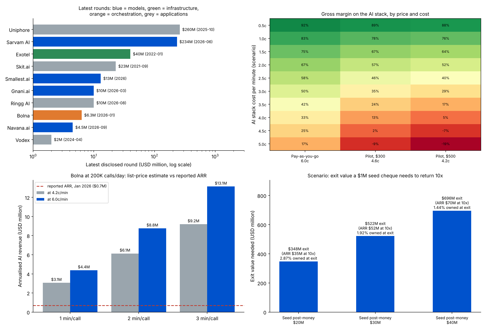

# India Voice AI Agents: Market Map and Investment Memo

An early-stage investor's view of Indian voice AI agents: who is building what, where the money has gone, what the unit economics of a voice-agent platform look like, and what to ask in technical diligence.

I built and ran a production voice AI calling agent at Tru Estate (1 lakh+ calls a day), so the cost and latency questions below come from operating one, not only from reading about them.

**Data:** `data/companies.csv` holds 6 companies. Every funding figure and metric comes from a public announcement linked in the file. Prices come from Bolna's public pricing page. Anything marked **ESTIMATE** or **SCENARIO** is my calculation on stated assumptions, not a reported number.



## Market map

| Layer | What it does | Companies | Latest disclosed round |
|---|---|---|---|
| **Models + platform** | Own speech and language models (STT, TTS, LLM) for Indian languages, plus an agent platform on top | Sarvam AI, Smallest.ai, Gnani.ai | $234M (Sarvam, Series B first close, Jun 2026), $13M (Smallest.ai, Series A, 2026), $10M (Gnani, Series B, Mar 2026) |
| **Orchestration** | Self-serve tooling to build, deploy and monitor agents; routes each call across third-party models | Bolna | $6.3M seed (Jan 2026) |
| **Applications** | Agents sold for a business outcome: lead qualification, collections, renewals, support | Ringg AI, Skit.ai | $10M (Ringg, Series A extension, Aug 2026), $23M (Skit, Series B, Sep 2021) |

## Key findings

| Area | Finding | Investment read |
|---|---|---|
| Where the money went | The 6 latest rounds total **$296M**. Model builders took **$257M (87%)**, and Sarvam alone **79%**. Excluding Sarvam, the median round is **$10M**. **5 of the 6** latest rounds closed in 2026. | Capital is concentrated in the model layer; the application and orchestration layers are still early and cheaper to enter |
| Traction | Bolna went from 1.5K to **200K+ calls a day** and has **1,050+ paying customers** (company figures). Sarvam reports **2M+ interactions a day**; Gnani, **200+ enterprises**. | Demand is real; the open question is who keeps the margin |
| Unit economics | Bolna's public price is **4.2–6.0 US cents a minute** for STT + LLM + TTS. To keep a **50%** gross margin on the AI stack, the stack must cost under **2.1–3.0c** a minute; for **70%**, under **1.3–1.8c**. | Orchestration margins depend on falling model prices, which the platform does not control |
| Cost-down lever (SCENARIO) | At the lowest public price (4.2c), cutting an assumed 3.5c stack cost by **75%** lifts margin from **17% to 79%**. | Whoever owns cost and latency (own models, routing, caching) owns the margin; ask every founder for their cost per minute |
| Revenue size (ESTIMATE) | 200K calls a day at 1–3 minutes a call and 4.2–6.0c a minute implies **$3.1M–13.1M** of annualised AI-stack revenue for Bolna. Revenue is not disclosed. | Sizes the business from public numbers; confirm with the founder's real minutes and price mix |

The full margin grid (stack cost 0.5–5.0c against the three public price points) is in `results/margin_grid.csv`.

## Investment view

1. **Model layer: a capital game.** Owning Indian-language speech models gives cost and latency control and a sovereignty story (Gnani's IndiaAI Mission selection, Sarvam's government work). It also needs large rounds and compute. For a seed or Series A fund, entry is hardest here.
2. **Orchestration layer: fast growth, margin risk.** Self-serve platforms grow quickly but resell other providers' models. The bet is that routing, evals and observability become the product, and that model prices keep falling faster than the platform's own prices.
3. **Application layer: outcome pricing.** Selling "renewals recovered" or "leads qualified" instead of minutes can protect margin, as long as the agent beats a human team on cost per outcome. Customer concentration and integration depth (CRM, telephony, payments) decide defensibility.

## Technical diligence checklist

| Area | What to ask or check |
|---|---|
| Latency | End-to-end response time (p50 and p95) on a real phone line, not in a demo; where the time goes across STT, LLM and TTS |
| Languages | Word error rate by language and accent; Hinglish and code-mixed speech; noisy lines |
| Model choices | Own models vs third-party APIs; cost per minute today and the plan to lower it; dependence on a single provider |
| Data pipelines | How call recordings and transcripts are stored, labelled and fed back into prompts or models; consent and data residency |
| Evals and observability | How a bad call is detected; which KPIs are tracked per call (containment, transfer to a human, task success); how a fix is tested before release |
| Infrastructure | Concurrency limits, telephony partners, uptime, fallbacks when a model provider fails |
| Reliability and safety | Guardrails on what the agent can promise; handling of payments and personal data; compliance with telecom rules on automated calls |

## Questions for founders

1. What is your fully loaded cost per minute today, and what was it 6 months ago?
2. What share of your revenue comes from the top 5 customers?
3. Which provider would hurt most if it raised prices or failed, and how fast could you switch?
4. What is your p95 latency and word error rate on your three biggest languages?
5. How do you price: per minute, per call or per outcome? What happens to gross margin as customers scale?

## Method

- **Market map:** companies grouped by the layer they mainly sell. Funding = latest disclosed round only, not total raised, so totals understate cumulative funding.
- **Gross margin** = 1 − (AI stack cost per minute ÷ price per minute). Price and cost both exclude telephony and platform fees, which Bolna bills separately.
- **Revenue triangulation** = calls a day × minutes a call × price a minute × 365.

## Limitations

- 6 companies, chosen as well-known and recently funded Indian voice AI players; not a complete census. Skit.ai's latest disclosed round is from 2021.
- Company metrics (calls, customers) are self-reported in announcements and not independently verified.
- The AI stack cost per minute is not public for any company, so margins are shown as a grid of scenarios, not as one figure.
- One price list (Bolna) anchors the economics; enterprise contracts are usually negotiated lower.

## Outputs

- `results/results.json`: every number in this README
- `results/margin_grid.csv`: gross margin by stack cost and price
- `results/summary.png`: the three charts above

## Run it

```bash
pip install pandas numpy matplotlib
python run_analysis.py   # writes everything in results/
```

## Sources

Links for every company row are in `data/companies.csv` (BusinessToday, Inc42, YourStory, Business Standard, and the Smallest.ai and Bolna company pages). Prices: bolna.ai/pricing, read in November 2026.
